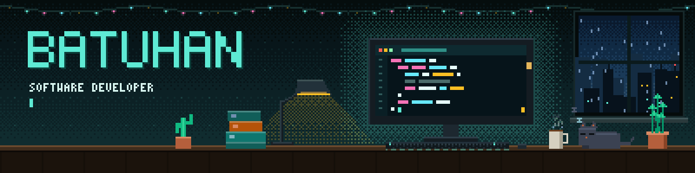

  

## About

Software developer focused on fullstack web: **Python and Node.js on the backend, React and TypeScript on the front.**

I come from an engineering background and moved into software development by choice. I built my foundations through my studies, strengthened them with fullstack courses, and keep sharpening them by shipping real projects: backend services, PostgreSQL / Supabase data layers, React single-page apps, and real-time dashboards over WebSockets.

- Currently deepening my backend skills (Python, Node.js, PostgreSQL) by shipping small full-stack projects.
- Building automation and AI-assisted tooling around my own workflow.
- Based in İzmir, studying Computer Science at Dokuz Eylül University.
- Background in the crypto space, so web3 is a domain I know well.

## Stack

## Selected work

| Project | What it is | Stack |
| --- | --- | --- |
| [**xwitter**](https://github.com/goktas-batuhan/xwitter) | Full-stack social app: REST API with authentication, JPA data layer, React frontend | Spring Boot, Spring Security, PostgreSQL, React |
| [**Govoo**](https://github.com/baemarc/Govoo) | Full-stack on-chain analytics app: a Node.js worker reads and decodes chain data into Supabase, a React frontend visualizes it, with row-level security and an admin page | TypeScript, Node.js, React, Supabase (PostgreSQL) |
| [**Parbshi**](https://github.com/goktas-batuhan/Parbshi) | Real-time arbitrage bot for Kalshi and Polymarket 15-minute crypto contracts, with a live dashboard | Python, FastAPI, WebSocket, React |
| [**teknolojik-yemekler**](https://github.com/goktas-batuhan/teknolojik-yemekler) | Food-ordering SPA with routing, forms and Cypress tests | React, Cypress |
